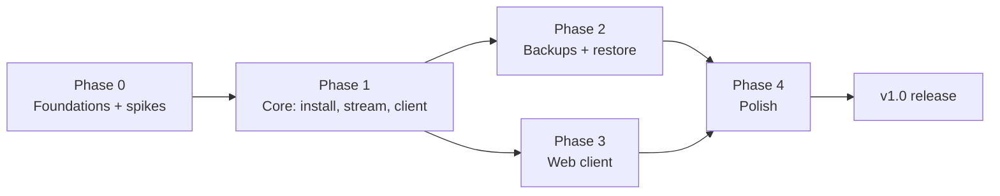
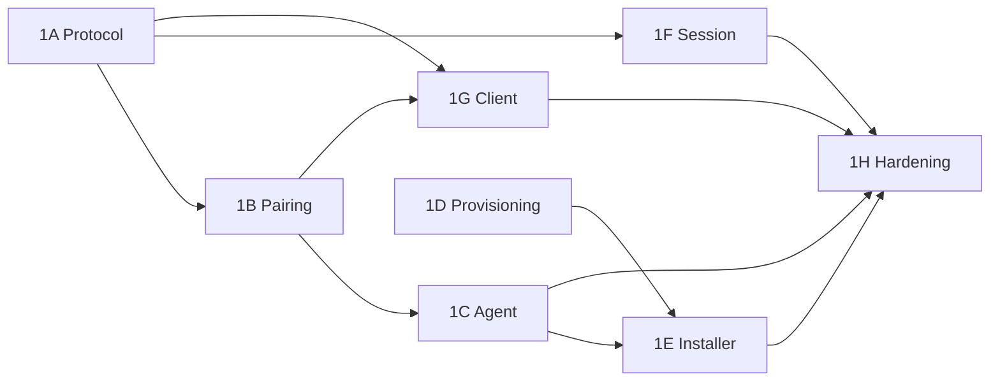

# Execution phases

The plan we follow to build hash-xcreen v1. Each phase ends at a **gate**: its exit criteria must all pass before the next phase starts. Design detail is in [architecture.md](architecture.md), libraries in [tech-stack.md](tech-stack.md), and the user experience in [userflow.md](userflow.md).

## Rules we work by

- **Gates are hard.** A phase is done when every exit criterion passes, not when the tasks are ticked.
- **Riskiest first.** Spikes in Phase 0 settle the unknowns before code depends on them. If a spike fails, we update the architecture and tech stack before continuing.
- **One owner per area.** Each workstream owns its crates and files; shared contracts (protocol, IPC commands, recipe format) have exactly one owner and their consumers start after the contract is merged.
- **Contracts before consumers.** `docs/protocol.md` and the `hx-privd` command set are written and reviewed before the code that uses them.
- **Every change on its own branch, committed locally first.** Branch from `main` (`phase-<n>/…`, `spike/…`, `docs/…`, `fix/…`, `chore/…`), commit each logical change locally as it is completed (Conventional Commits, `git commit -s`), and merge into `main` later through a PR with CI green. Nothing is committed directly to `main`. Full rules in [AGENTS.md](../AGENTS.md).
- **Security-sensitive changes** (pairing, auth, privilege boundaries, secrets, parsers) get an independent security review before merge.
- **Status** is tracked with the checkboxes below; update them in the same PR that completes the work.

Size: **S** = days, **M** = one to two weeks, **L** = several weeks (for one focused developer).

## Overview

Phases 2 and 3 can run in parallel once Phase 1 passes its gate; backups come first if only one can be staffed, because they are the core promise.

---

## Phase 0 — Foundations and spikes

### 0.1 Repository foundations (S)

- [x] Cargo workspace with the crate and app layout from architecture §3 (empty crates that compile)
- [x] `LICENSE` (AGPL-3.0), `SECURITY.md`, `CONTRIBUTING.md` (DCO, Conventional Commits)
- [x] CI: `cargo fmt --check`, `clippy -D warnings`, `cargo nextest`, `cargo-deny` (licences + advisories), `cargo-audit`, DCO check
- [x] Renovate configuration
- [x] `rust-toolchain.toml` pinning stable

### 0.2 Spikes

Each spike is throwaway code in `spikes/<name>/`, time-boxed, and ends with a short written result in `docs/spikes/<name>.md`: what was measured, the numbers, and the decision.

**S1 — Slint video presentation** (time box: 1 week)
- Goal: show hardware-decoded 1080p60 H.264 in a Slint window with no CPU copy per frame.
- Method: libavcodec + VAAPI decode → wgpu texture → `slint::Image`; compare with an OpenGL underlay and a CPU upload path.
- Pass: sustained 60 fps with even frame pacing; decode to render complete ≤ 8 ms (restated after S1: with vsync at 60 Hz a frame waits ~8.3 ms on average before scan-out whatever the path, so a literal 8 ms decode-to-photon target is unattainable); UI stays responsive.
- Decides: the client rendering path.

**S2 — Streaming loop** (time box: 2 weeks)
- Goal: prove the latency and CPU budget end to end.
- Method: XFCE on headless Xorg in an Incus container → XDamage/XShm capture → `yuvutils-rs` → x264 (`ultrafast`, `zerolatency`, intra refresh) → quinn, one stream per frame → headless client decode. Per-stage timestamps; scenarios: idle, typing, scrolling, video, window drag; `tc netem` LAN and 50 ms profiles.
- Pass (4 vCPU, no GPU): added latency ≤ 40 ms p95 on LAN; ≤ 1.5 cores while typing or scrolling; ~0 CPU and bandwidth when idle.
- Decides: encoder settings, threading model, frame-per-stream versus alternatives.

**S3 — Incus desktop on a VPS** (time box: 1 week)
- Goal: confirm the desktop fits the minimum server and both image paths work.
- Method: fresh Ubuntu 24.04 and Debian 13 VPSs at 2 vCPU / 4 GB and 4 vCPU / 8 GB; Incus with a loop-file btrfs pool; unprivileged XFCE + PipeWire container; Docker with nesting; time a prebuilt image import against building on the server.
- Pass: desktop idle with ≥ 1.5 GB RAM free on the minimum spec; Docker `hello-world` runs nested; prebuilt path < 5 min, build path < 20 min.
- Decides: minimum spec confirmation, pool defaults, recipe format.

**S4 — Backup round trip** (time box: 1 week)
- Goal: prove full-desktop backup and restore through Google Drive.
- Method: `rustic_core` with OpenDAL's `gdrive` backend (`drive.file` token from a PKCE desktop flow); back up a mounted snapshot of the S3 container with zstd; simulate a day of use and back up again; restore into a fresh container; check Claude Code and Codex CLI history and logins survive.
- Pass: restored desktop boots with everything intact; typical daily increment < 500 MB; interrupted upload resumes without re-uploading.
- Decides: OpenDAL vs rclone backend, exclude list defaults, compression level.

**S5 — Browser transport and certificates** (time box: 3 days)
- Goal: confirm the web client's foundations.
- Method: WebTransport server (`wtransport` or `h3` + quinn) on the same port as native QUIC; test Chromium, Firefox and Safari; issue a Let's Encrypt IP-address certificate with `instant-acme`; WebCodecs decode of the S2 stream.
- Pass: WebTransport works in Chromium and Firefox (Safari status recorded); IP certificate issues and renews; browser decode at 1080p60.
- Decides: WebTransport library, Safari fallback (WebSocket), certificate strategy without a domain.

### 0.3 Spike results (2026-11-20)

All five spikes ran locally on an Ubuntu 24.04 VM (16 cores, no GPU, no KVM, shared by all five spikes at once, so timings are indicative). Full reports are in `docs/spikes/`.

| Spike | Result | Decision | Still unproven |
|---|---|---|---|
| [S1](spikes/s1-slint-video.md) Slint video | All criteria UNVERIFIED (no GPU); every path builds and runs or reports why it can't | Provisional: VAAPI → DMA-BUF → EGL → OpenGL texture → Slint borrowed texture; CPU upload as fallback; wgpu route kept as an option | Every performance number; needs the GPU run |
| [S2](spikes/s2-streaming-loop.md) Streaming loop | PASS: p95 added latency 24.6–34.6 ms (typing, scroll, drag), 40.5 ms video; encoder 0.5–0.6 cores; idle 0.01 cores and 0 bytes. On a quiet VPS: 10.7–16.5 ms, and 20.4–24.8 ms over the internet | x264 settings, capture-when-free pacing, dedicated threads, frame-per-stream with ack-driven congestion control | Quiet-VPS re-measure; decoded-pixel fidelity; jitter-adaptive controller |
| [S3](spikes/s3-incus-desktop.md) Incus desktop | PASS locally: 3.5–3.9 GB free at 2 vCPU / 4 GB; prebuilt ~1.5–2.5 min; build 3.5–5 min. **FAIL: nested Docker** on Docker's default bridge | Minimum spec kept; btrfs pool sized to the disk; TOML recipe format; sysctl inotify limits required | Real-VPS numbers; metadata-address ACL; Docker on newer Incus |
| [S4](spikes/s4-backup-roundtrip.md) Backup round trip | PASS locally: 2.24 GB desktop → 906 MB; 98 MB simulated day; bit-exact restore that boots; SQLite intact; resume works with `repair index` | zstd level 3; OpenDAL `gdrive` behind an hx retry wrapper (rclone fallback); revised exclude/protected rules | Everything on real Google Drive |
| [S5](spikes/s5-webtransport.md) Browser transport | PASS: one port for WebTransport and native QUIC; Chrome decodes 1080p60; Firefox transport works | `wtransport` on our quinn endpoint with ALPN dispatch; WebSocket fallback for Safari; IP certificate or pinned self-signed certificate | Real IP-certificate issuance; Safari; Firefox decode on real hardware |

### 0.4 Follow-up runs before Gate 0 closes

These needed hardware or accounts the spike machine didn't have. They ran on 2026-11-20 on a throwaway 4 vCPU VPS (Ubuntu 26.04, Incus 6.0.5) and a real Google Drive test account, except where noted. Each spike report has a section for its run.

- [ ] **S1 GPU run:** on a Linux PC with an Intel or AMD GPU, preferably a Wayland session, run `spikes/s1-slint-video/run-gpu-bench.sh` (see `RUN_ON_GPU.md`). **Deferred to before workstream 1G** (desktop client video): no GPU machine yet. Nothing before 1G depends on it, and the CPU-upload fallback is a working floor.
- [x] **S3 VPS run:** all S3 criteria PASS on the VPS: 3.45–3.93 GB free at 2 vCPU / 4 GB, build on the server 86–206 s, prebuilt 16–29 s plus download, metadata-address and host-IP rules verified, inotify failure reproduced and fixed. New: Debian 13 guests need `raw.apparmor "signal,"` on this kernel; host Docker does cut container IPv4 (two `DOCKER-USER` rules fix it). Ubuntu 24.04 and Debian 13 **hosts**, a real 4 GB server and reboot persistence of the firewall rules are deferred to the 1E installer test matrix.
- [x] **Docker decision:** nested Docker on Docker's default bridge works on Incus 6.0.5 (failed on 6.0.0). Decision: nesting + syscall interception on Incus ≥ 6.0.5, an installer self-test (`docker run --rm hello-world`), then fallbacks in order: Zabbly Incus, host-network-only Docker, Incus VM (not v1). See architecture §4.3.
- [x] **S4 Drive run:** `drive.file` is enough. Full backup 2.44 GB → 1.0 GB in 125 s, simulated day 98 MB, restore exact (81,070 entries) and boots, `repair index` resume works on Drive, retry wrapper tested by fault injection. New: Drive deletes go to the trash and keep using quota, so the backend must delete permanently; one fixed OAuth client is required. Real rate-limit replies, packs ≥ 128 MB, slow uplinks and token revocation are deferred to Phase 2's nightly Drive test.
- [x] **S5 public-server run:** Let's Encrypt IP certificates issued and renewed in production (160 h, ARI), and Chrome and Firefox ran WebTransport over the internet on IPv4. Chrome fails to an IPv6 literal (WebSocket fallback covers it). **Safari deferred to Phase 3** (needs a Mac).
- [x] **S2 quiet re-measure:** PASS with 3 repeats per scenario: p95 10.7–16.5 ms on the same host and 20.4–24.8 ms over the internet (14 ms RTT), 0.45–0.75 server cores, idle about 0. Decoded fidelity 47 dB while typing, 34–44 dB in motion; colour correct once the stream is tagged BT.709. Lossy-link behaviour on a real path is deferred to workstream 1F (`tc netem` had no effect through the Incus proxy device).

### Gate 0

- [x] All five spike reports written
- [x] Every failed criterion has an accepted alternative (nested Docker: self-test with fallbacks, §0.4)
- [x] `architecture.md` and `tech-stack.md` updated with spike outcomes (remaining uncertainties marked **(provisional)**)
- [x] CI foundations green on `main`
- [x] Follow-up runs in 0.4 done, or explicitly deferred with a reason (S1 GPU run before 1G; Safari in Phase 3; other hosts in 1E; real rate limits in Phase 2)

---

## Phase 1 — Core: install, stream, connect

### Workstreams

| # | Workstream | Owns | Depends on | Size |
|---|---|---|---|---|
| 1A | Protocol and transport | `hx-proto`, `hx-transport`, `docs/protocol.md` | Gate 0 | M |
| 1B | Crypto and pairing | `hx-crypto` | 1A (handshake messages) | M |
| 1C | Agent core | `apps/hx-agent` (`hx-gatewayd`, `hx-privd`, CLI), systemd units, privd command set | 1A, 1B | L |
| 1D | Provisioning | `hx-provision`, `recipes/`, image CI | Gate 0 | L |
| 1E | Installer | `installer/install.sh`, the installer engine `apps/hx-agent/src/install/` (`hx-agent install`, `hx-agent uninstall`), `.github/workflows/release.yml` and `installer-vm.yml`, `packaging/`, `release/`, `apps/hx-pwcheck`, preflight, stages | 1C, 1D | M |
| 1F | Session streaming | `hx-capture`, `hx-codec` (encode), `apps/hx-session` | 1A | L |
| 1G | Desktop client | `apps/hx-desktop`, `hx-codec` (decode) | 1A, 1B, design mockups | L |
| 1H | Hardening | fuzz targets, perf suite, security review | 1A–1G | M |

### 1A — Protocol and transport
- [x] `docs/protocol.md`: handshake, versioning, channel table, every control message, media header layout
- [x] Protobuf schema and generated types; media header encode/decode
- [x] QUIC endpoint and client with the channel layout (streams, datagrams, priorities); WebSocket fallback
- [x] Property tests for every message round trip

### 1B — Crypto and pairing
- [x] Identity and device keys; pinned-key TLS verification in rustls
- [x] SPAKE2 pairing for long tokens and short codes; token expiry and single use
- [x] PIN verification (Argon2id) with lockout and device revocation

### 1C — Agent core
- [x] `hx-privd` command set specified and reviewed before implementation ([ipc.md](ipc.md) v0.3; the session link too)
- [x] `hx-gatewayd` unprivileged with systemd hardening and seccomp allowlist
- [x] Unix-socket IPC: gateway ↔ privd, gateway ↔ session
- [x] Device list and revocation; `hx-agent` CLI (status, devices, logs, uninstall; `uninstall` closed with the 1E work, split between the CLI and a narrowed privd `Uninstall`, ipc.md §6.13; both modes run for real in docs/spikes/1e-installer-nested-incus.md)
- [x] Self-update with signature check and rollback

### 1D — Provisioning
- [x] Recipe format and recipes for Ubuntu 24.04 / 26.04 and Debian 12 / 13 × XFCE × basic / developer (all eight built for real in an unprivileged Incus container, see recipes/README.md)
- [x] Incus orchestration: pool, unprivileged container, limits, network rules (metadata endpoint and agent ports blocked; host ruleset generated by `hx-provision`, loaded and persisted by 1C/1E)
- [ ] Prebuilt image CI (weekly, signed) and build-on-server path from the same recipe; `--image auto` selection with reasons
- [ ] CI equivalence check between the two paths
- [ ] Docker opt-in (nesting, syscall interception, apt install)

### 1E — Installer
- [x] `install.sh`: preflight, download, minisign verification (current and next key), hand-off to the agent
- [ ] All options from architecture §5.2; `--interactive` mode with pairing code (implemented and tested against a simulated host; `--ssh` ran for real. Still to run on a real host: `--interactive`, `--docker`, and a host that needs Zabbly, now that its pinned apt key is embedded)
- [x] Idempotent stages with resume; `hx-agent uninstall` (resume after every stage, a no-op re-run and both uninstall modes run for real in a nested Incus container on Ubuntu 24.04 and Debian 13: docs/spikes/1e-installer-nested-incus.md)
- [ ] Installer CI: fresh VM per host OS × both image paths

Design: architecture §4.1, §4.2, §5 and §13, and ipc.md §5.4, §6.12 and §6.13 (written before the code, as AGENTS.md requires). Notes:

- Host OSes are Ubuntu 24.04, 26.04, Debian 12 and 13; Ubuntu 22.04 is dropped (systemd 249 has no `systemd-creds`).
- **The one-liner stops after pairing in 1E.** `--pair` installs the agent, opens the port and installs the pairing token typed at a hidden prompt, then ends. The post-pairing setup protocol (password, PIN and `CreateDesktop` from the app over gatewayd) does not exist yet and is designed in 1G (box below), so Gate 1's "via the one-liner" cannot pass before it. 1E delivers `--ssh` and `--interactive` in full.
- **Prebuilt in the CI box.** 1E can deliver the `build` cells for every host OS, and `prebuilt` cells that assert the clean refusal (exit 6, nothing changed; privd answers `UNIMPLEMENTED`). The "both image paths" part of the box stays open until 1D's prebuilt image CI lands, or the box is split then.
- The release needs the maintainer's minisign keys: `release-keys/*.pub` stay `UNPROVISIONED`, and the release gate refuses a release, until the maintainer generates both keys and sets the `release-signing` environment secrets.
- The desktop recipes must pre-install the FFmpeg runtime libraries per distro (a recipe variable), because privd installs `hx-session` with `dpkg -i`, which resolves no dependencies.

### 1F — Session streaming
- [x] X11 capture backend (XDamage, XShm, XFixes cursor, RandR resize)
- [x] Encode pipeline on dedicated threads with buffer pools; x264 settings from S2
- [x] Source-side congestion control, intra refresh, stale-frame cancellation, bandwidth cap
- [x] Input injection (XTest, scancodes), cursor channel, clipboard (text, images, files) both ways

### 1G — Desktop client
- [ ] S1 GPU run done (deferred from Phase 0, §0.4) and the rendering path confirmed or switched to the fallback
- [ ] Design mockups (dark-first + light) approved before UI implementation
- [ ] Post-pairing setup protocol for the one-liner path (password, PIN and `CreateDesktop` from the app over gatewayd during `SETUP_OPEN`), specified in protocol.md and ipc.md; 1E's `--pair` ends before it
- [ ] Home, Add server wizard (SSH and one-liner paths), live progress, connect with PIN
- [ ] SSH setup via `russh` with host-key confirmation
- [ ] Desktop view with the rendering path from S1; toolbar, stats overlay, reconnect overlay
- [ ] Device key in the system keyring; Server details (Overview, Security, Desktop, Danger zone)
- [ ] `.deb` and AppImage packaging

### 1H — Hardening
- [ ] Fuzz targets for every pre-auth and container-supplied parser, running nightly
- [x] Performance suite on the dedicated runner with regression thresholds (criterion benches, the LAN end-to-end macro run and `perf/check.py` against `perf/baseline.json`; the workflow targets the `hx-perf` label and stays inactive until the maintainer registers a runner, see [testing.md](testing.md); `perf/run.sh` runs it locally meanwhile)
- [x] End-to-end tests: install → pair → connect → type and scroll → disconnect, under netem profiles (`e2e_netem.rs`, unprivileged veth + netem, every profile measured; the lossy profile currently exposes a corrupt-picture defect, [testing.md](testing.md) section 2.8)
- [ ] Independent security review of 1B, 1C and 1E; findings fixed

### Gate 1

- [ ] On a fresh 4 vCPU VPS, a user goes from **Add server** to a working XFCE desktop in the app without touching the server (SSH path) and via the one-liner
- [ ] Re-running a failed install resumes and succeeds
- [ ] Added latency ≤ 40 ms p95 on LAN; idle ≈ 0 CPU and bandwidth; typing/scrolling ≤ 1.5 cores
- [ ] Wrong PIN ×5 revokes the device; revoked devices cannot connect
- [ ] No secret appears in any command line, log or process list
- [ ] Security review findings resolved; fuzzers clean for 7 nights

---

## Phase 2 — Backups and restore

| # | Workstream | Owns | Size |
|---|---|---|---|
| 2A | Backup engine | `hx-backup`: rustic_core, Drive backend, excludes and protected paths, manifest | L |
| 2B | Scheduling and operations | scheduler, catch-up, upload cap, retention, prune, verification, quota handling, alerts | M |
| 2C | Restore | restore to same server and new server, safety snapshot, resume | L |
| 2D | Client backup UI | Google sign-in, wizard Backups step, recovery key, Backups tab, warnings | M |

### Tasks
- [ ] Backup worker spawned by `hx-privd`; snapshot → read-only mount → rustic → manifest → cleanup
- [ ] Exclude rules and protected list; property test that protected paths are never excluded
- [ ] Docker backup modes: Complete and Light
- [ ] Recovery key generation and display; Drive token sealed with `systemd-creds`
- [ ] Scheduler: fixed times, jitter, catch-up, no overlap; nice/ionice; 50% upload cap during sessions
- [ ] Failure handling per architecture §9.6
- [ ] Quota estimate, 80/95% warnings, auto-prune to the two-backup floor, then stop and notify
- [ ] Retention defaults; weekly prune; weekly metadata check; monthly 5% data check
- [ ] Restore into temporary container, resume, boot check, swap, 7-day safety snapshot
- [ ] Restore onto a new server from the app (Drive sign-in, backup picker, recovery key)
- [ ] ntfy and webhook alerts; missing-backup detection in the client
- [ ] Nightly real-Drive tests including the AI and chat app history test

### Gate 2

- [ ] 12h and 24h schedules run unattended for 7 days on a test server; increments within S4 numbers
- [ ] Restore onto a **different** fresh server produces a desktop with apps, files, Docker data, Claude Code and Codex history and logins intact
- [ ] Killing the agent mid-backup and cutting the network mid-restore both recover without user action
- [ ] Drive-full and revoked-token scenarios behave as designed
- [ ] Security review of the backup worker, key handling and restore path

---

## Phase 3 — Web client

| # | Workstream | Owns | Size |
|---|---|---|---|
| 3A | Web transport and hosting | WebTransport endpoint, WebSocket fallback, `axum` hosting, certificates | M |
| 3B | Web auth | enable/disable switch, password + PIN, passkeys, rate limits and lockouts | M |
| 3C | Web app | WASM protocol core, TypeScript shell, WebCodecs, canvas, Pointer/Keyboard Lock, clipboard, Server details | L |

### Tasks
- [ ] Web access off by default; enabling from the desktop app shows the address
- [ ] Let's Encrypt for `--domain`, IP certificate otherwise, automatic renewal
- [ ] First login password + PIN; passkey registration; passkey + PIN afterwards
- [ ] Desktop view and toolbar parity with the desktop app
- [ ] Playwright tests in Chromium and Firefox

### Gate 3

- [ ] Web client meets the same latency target in Chromium on LAN
- [ ] Web access disabled means the login page is unreachable
- [ ] Security review of web auth and the browser-facing surface

---

## Phase 4 — Polish

- [ ] Opus audio from the desktop
- [ ] File drag-and-drop and transfer progress
- [ ] Sharp-text refinement
- [ ] SVT-AV1 where CPU and client allow
- [ ] VAAPI and NVENC encoding when a GPU exists
- [ ] Docker toggle UI and Light/Complete switch in Server details
- [ ] Upgrade tests (previous release ↔ new release)
- [ ] Accessibility and keyboard navigation pass on the desktop app

### Gate 4

- [ ] All scenario performance targets met on the dedicated runner
- [ ] Upgrade tests pass

---

## v1.0 release checklist

- [ ] Google OAuth app published to production, brand verification complete
- [ ] Release signing keys generated; current and next public keys embedded in `install.sh`
- [ ] GitHub build provenance attestations on all artifacts
- [ ] Stable and beta channels live; prebuilt images for all four guest distros
- [ ] Docs published on GitHub Pages: install, user guide, protocol spec, security model
- [ ] Final independent security review of the full release
- [ ] Dedicated Google test account in place for nightly backup tests

## After v1

KDE Plasma and GNOME backends, Windows and macOS clients, mobile clients, 120 fps, multi-monitor, microphone input, more backup targets, arm64 servers, custom domain, Flatpak.
