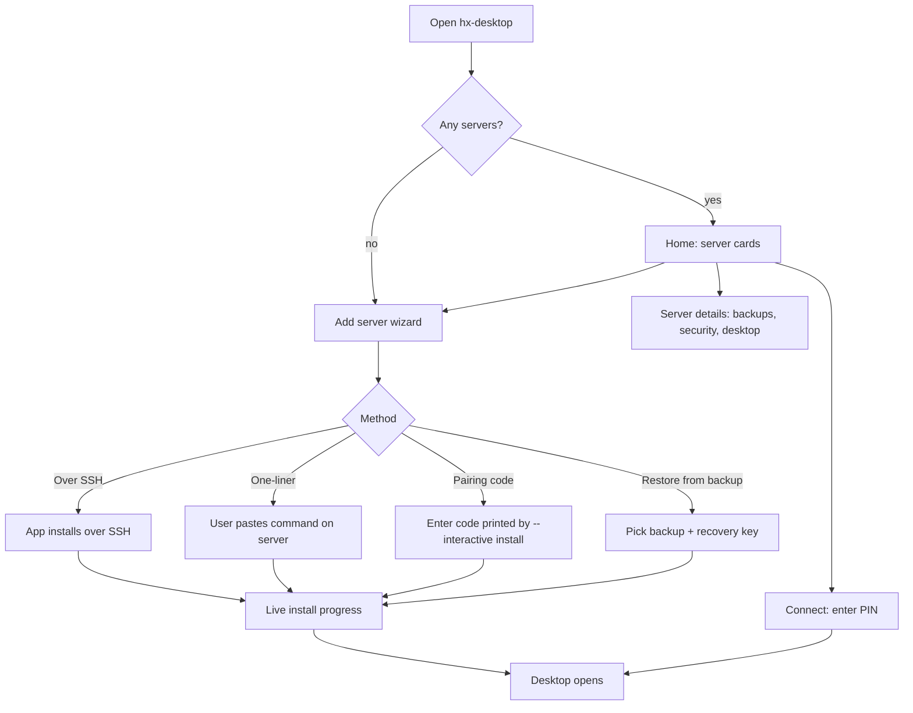

# User flows

What the user sees and does, step by step. Technical detail lives in [architecture.md](architecture.md); this document is about the experience.

## Map of flows



## 1. First launch

1. The user opens **hx-desktop**.
2. With no servers yet, the app shows a short welcome: what hash-xcreen does and an **Add server** button.
3. The theme follows the system (dark-first design, light theme available).

## 2. Add a server over SSH (main path)

1. **Method**: the user picks **Over SSH**.
2. **Connection**: server address, SSH port, username, and either an SSH key (default: the user's existing keys) or a password.
   - The password is used for this install only and never stored.
   - The app shows the server's **host-key fingerprint**; the user confirms it the first time.
   - The app checks the server meets the minimum (2 vCPU, 4 GB RAM, 30 GB disk, supported OS). If not, it says exactly what is missing and stops.
3. **Desktop**: distro (Ubuntu 24.04 / 26.04, Debian 12 / 13), desktop (XFCE), preset (**basic** or **developer**), Docker switch (with a short warning about weaker isolation).
4. **Account**: Linux username, password (strength meter), PIN (6+ digits, entered twice).
5. **Backups**:
   - **Connect Google Drive** opens the user's normal browser for Google sign-in; the app returns to the wizard when done. Can be skipped.
   - Schedule: every 12h, every 24h, or off; backup times (for example 03:00 and 15:00).
   - Retention: defaults shown, editable.
   - Estimated size: "About 6.2 GB first backup, then about 50–300 MB per backup", with a warning if Drive does not have room.
   - **Recovery key**: shown once. The user saves it and re-types a few of its words to continue.
6. **Resources**: CPU, memory and disk sliders limited to what the server has. Advanced: port, domain, enable web access.
7. **Review**: a summary of every choice; **Install**.
8. **Progress**: a checklist of stages with the current one animated, an expandable log, and the image path chosen and why ("Using prebuilt image (about 4 min)" or "Building on the server: release host unreachable (about 12 min)").
9. **Done**: the desktop opens in the app. The first backup runs in the background; its progress shows on the server card.

If the install fails, the app shows the failing stage, the reason, and **Retry**, which resumes from that stage.

## 3. Add a server with the one-liner

1. **Method**: **Copy one-liner**.
2. The user enters the server's address, then completes the same Desktop, Account, Backups and Resources steps.
3. The app shows the command with a **Copy** button. The command holds **no token and no secret**, so it is safe in the shell history and the server's logs:
   ```bash
   curl -fsSL https://github.com/Omakidx/hash-xcreen/releases/download/channel-stable/install.sh | sudo sh -s -- --pair --distro ubuntu-24.04 --desktop xfce --user alex --backup 12h
   ```
   Below it the app shows the one-time **pairing token** (`hxt1-…`) with its own **Copy** button, and a note that it expires 15 minutes after the installer takes it and works once.
4. The user pastes the command into a root shell on the server. The installer checks the server, installs the agent and opens the port, then asks for the token; the user pastes it (nothing is echoed). The app shows "Waiting for the server…".
5. As soon as the agent is listening, the app pairs automatically. The installer has finished at this point; what happens next (sending the password, PIN and Drive token over the encrypted connection, creating the desktop, and the live progress view) needs setup messages that are designed in workstream 1G, so until that work lands this path ends at a paired server with no desktop.
6. If the token expires first, the app offers **Generate a new token**.

## 4. Install without the app

1. The user runs `install.sh --interactive` on the server.
2. The installer asks for each setting; the password and PIN are typed with hidden input.
3. At the end it prints a **pairing code**, the server's addresses and the port. The code is valid for 15 minutes; `hx-agent pairing code` prints a new one.
4. Later, in the app: **Add server → Enter pairing code**. The server card appears and the user connects with their PIN.

## 5. Connect to a desktop

1. On the home screen, the user clicks **Connect** on a server card.
2. The app asks for the **PIN**.
   - Wrong PIN: "Incorrect PIN, 4 attempts left".
   - Fifth wrong PIN: the server revokes this device. The app explains that it must be paired again, which needs the account password.
3. The desktop appears, sized to the window.
4. If the network drops: a "Reconnecting…" overlay; the desktop keeps running on the server and the view returns when the connection does.

## 6. Using the desktop

- **Toolbar**: hidden; slides in at the top edge or with `Ctrl+Alt+Shift`.
  - Display: fullscreen; fit to window, actual size, or resize the remote screen to match.
  - Quality: Auto, Sharp (text), Smooth (motion).
  - Stats: fps, latency, bitrate, codec, software or GPU encoding.
  - Keyboard: capture all keys on or off; send `Ctrl+Alt+Del` and other combinations.
  - Transfers: clipboard and file activity.
  - Disconnect.
- **Clipboard**: copying text, images or files on one side and pasting on the other just works, in both directions.
- **Files**: drag files from the local machine into the desktop window; a progress bar shows large transfers.

## 7. Backups

### See backup status

- Each server card shows the last backup's time and result.
- **Server details → Backups** shows a timeline of every backup (time, size, result), Drive space used out of the quota, the schedule, retention, and the **Last verified** date.

### Back up now

The user clicks **Back up now**; progress shows on the timeline.

### Restore onto the same server

1. **Backups → pick a backup → Restore**.
2. The app explains that the current desktop is kept as a safety snapshot.
3. Progress view; the restored desktop opens when ready.
4. A banner asks **Keep this restore?** The old desktop is deleted when the user confirms, or after 7 days.

### Restore onto a new server ("my server is gone")

1. **Add server → Restore from backup**.
2. Sign in to Google Drive; the app lists servers that have backups and their backup timelines.
3. Pick a backup; enter the **recovery key**.
4. Choose how to reach the new server (SSH or one-liner), as in flows 2 and 3.
5. The installer restores the desktop instead of building a new one. The user connects with their usual PIN and finds everything as it was, signed in to their apps.

## 8. Security settings

**Server details → Security**:

- **Paired devices**: name, last seen; **Revoke** any device.
- **Change PIN** and **Change password** (the password change also updates the Linux account).
- **Web access**: off by default. Turning it on shows the web address and explains the first login.
- **Passkeys**: list and remove passkeys registered from browsers.

## 9. Web client

1. The user enables web access in the desktop app and opens the shown address in a browser.
2. **First login**: password + PIN; then the browser offers to register a **passkey**.
3. **Later logins**: passkey + PIN.
4. The desktop and toolbar work as in the app; **Server details** is available too.
5. Not available on the web: adding servers over SSH and restoring onto a new server.

## 10. Desktop settings

**Server details → Desktop**:

- **Docker** switch: turning it on shows the isolation warning, then restarts the desktop with Docker installed. Backup mode: **Complete** (default) or **Light**.
- Resource limits; **Restart desktop**; **Update agent** (also automatic on the chosen channel).

**Server details → Danger zone**: **Uninstall**, with a choice to keep or delete the desktop.

## 11. Alerts and problems

| Situation | What the user sees |
|---|---|
| Backup failed | Red badge on the server card and a desktop notification; details and **Retry** in Backups |
| Google Drive disconnected | "Action needed: reconnect Google Drive" with a **Reconnect** button |
| Drive above 80% / 95% | Warning badge with a breakdown of space used |
| Drive full | Old backups pruned automatically (never below the two latest); if still full, backups stop and the user is told why |
| Backups missing from Drive | Red warning: backups were deleted outside the app |
| No successful backup for twice the interval | Red badge regardless of cause |
| Server offline | Grey card with "Last seen …" |
| Update available | Small badge; updates apply automatically on the chosen channel |

Optional server-side alerts for when the app is closed: **ntfy** push and **webhooks**, set in **Server details → Backups → Alerts**.

## 12. App settings

Theme, keyboard shortcuts, default quality, start at login, clipboard settings for this device, and bandwidth cap (Auto, 5, 10, 25, 50 Mbps).
