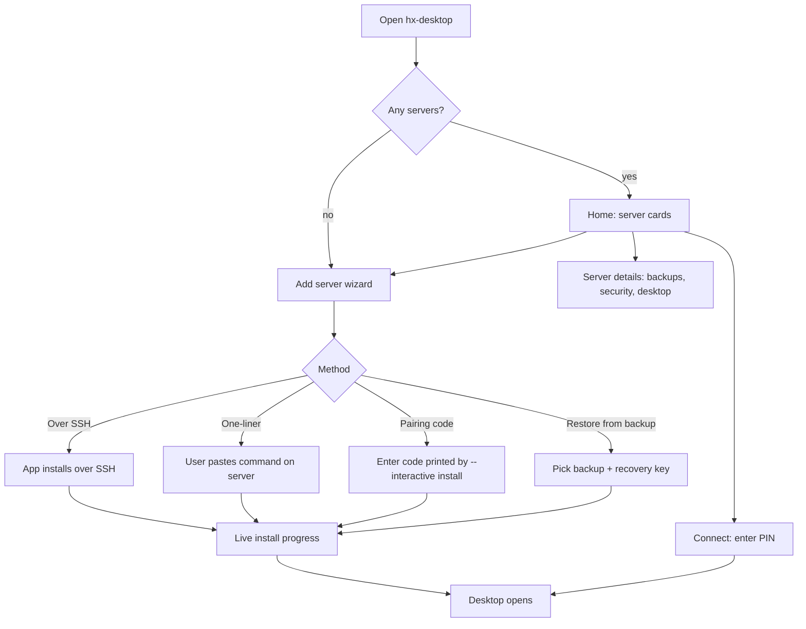

# User flows

What the user sees and does, step by step. Technical detail lives in [architecture.md](architecture.md); this document is about the experience. The screens are drawn in [`design/mockups/`](../design/mockups/README.md), which the maintainer approved as they are (2026-11-22); the mockups are the visual reference for the app, and this document is the behaviour.

**Phases.** Backups, web access, passkeys and alerts belong to Phases 2 and 3. Their flows are written below and tagged *(Phase 2)* or *(Phase 3)*, but the **Phase 1 app hides them** (no disabled controls, no "coming soon"); they appear when their phase is built. The window has a system title bar and a 900 x 600 minimum size.

## Map of flows



## 1. First launch

1. The user opens **hx-desktop**.
2. With no servers yet, the app shows a short welcome: what hash-xcreen does and an **Add server** button.
3. The theme follows the system theme by default (dark is the designed-first look; a light theme is available, and **App settings** can force either).

## 2. Add a server over SSH (main path)

1. **Method**: the user picks **Over SSH**.
2. **Connection**: server address, SSH port, username, and either an SSH key (default: the user's existing keys) or a password.
   - The password is used for this install only and never stored.
   - The app shows the server's **host-key fingerprint**; the user confirms it the first time.
   - The app checks the server meets the minimum (2 vCPU, 4 GB RAM, 30 GB disk, supported OS). If not, it says exactly what is missing and stops. Each check shows **what the server reports and the threshold**: a "4 GB" server never reports 4096 MiB, so the memory check passes at 3584 MiB (3.5 GB) and says so, instead of looking short.
3. **Desktop**: distro (Ubuntu 24.04 / 26.04, Debian 12 / 13), desktop (XFCE), preset (**basic** or **developer**), Docker switch (with a short warning about weaker isolation).
4. **Account**: Linux username, password (at least 8 characters, entered twice; the strength meter is advisory and never blocks), PIN (6 to 16 digits, entered twice). Continue is disabled until the username is valid, the passwords match and the PIN rule holds.
5. **Backups** *(Phase 2; the Phase 1 app has no Backups step and records backups as off)*:
   - **Connect Google Drive** opens the user's normal browser for Google sign-in; the app returns to the wizard when done. Can be skipped.
   - Schedule: every 12h, every 24h, or off; backup times (for example 03:00 and 15:00).
   - Retention: defaults shown, editable (every 12h keeps the latest 14, 4 weekly and 6 monthly; every 24h keeps 7 daily, 4 weekly and 6 monthly, architecture §9.7).
   - Estimated size: "About 6.2 GB first backup, then about 50–300 MB per backup", with a warning if Drive does not have room.
   - **Recovery key**: shown once. The user saves it and re-types a few of its words to continue.
6. **Resources**: CPU, memory and disk sliders limited to what the server has. Advanced: port, and a domain (recorded only for now). *Enable web access* is a Phase 3 control and is hidden in Phase 1.
7. **Review**: a summary of every choice; **Install**.
8. **Progress**: a checklist of **ten grouped rows** (the installer's 19 stages grouped, the real stage ids in small grey text) with the current one animated, a step with no percentage shown as an indeterminate bar, an expandable log, and the image path chosen and why ("Using prebuilt image (about 4 min)" or "Building on the server: release host unreachable (about 12 min)"; the reason comes from the server's reason code, architecture §4.3). The window can be closed: the install continues on the server.
9. **Done**: the desktop opens in the app (**Open desktop** asks for the PIN). *(Phase 2)* The first backup runs in the background; its progress shows on the server card.

If the install fails, the app shows the failing stage, the reason, and **Retry**, which resumes from that stage. If the failure is not retryable (for example a verification failure) the primary button becomes **Copy log**.

**SSH connection lost during the install.** The app shows "Connection to the server was lost" with the stage reached; finished stages are kept on the server. Secrets are never stored (architecture §5.3), so **Retry asks again** for the SSH password (or key passphrase), the account password and the PIN, then runs the same installer command, which skips finished stages and carries on.

## 3. Add a server with the one-liner

The one-liner installs only the **agent**. Everything about the desktop (distro, preset, username, password, PIN, Docker, limits) is chosen in the app and sent after pairing, over the encrypted connection, so the command carries no desktop option and no secret.

1. **Method**: **Copy one-liner**.
2. The user enters the server's address, then completes the same Desktop, Account and Resources steps as over SSH (and Backups *(Phase 2)*). Nothing is sent yet; the choices wait in the app.
3. The app shows the command with a **Copy** button. It holds **no token and no secret** and only host options, so it is safe in the shell history and the server's logs:
   ```bash
   curl -fsSL https://github.com/Omakidx/hash-xcreen/releases/download/channel-stable/install.sh | sudo sh -s -- --pair --port 443 --channel stable
   ```
   Below it the app shows the one-time **pairing token** (`hxt1-…`) with its own **Copy** button, and a note that it expires 15 minutes after the installer takes it and works once.
4. The user pastes the command into a root shell on the server. The installer checks the server, installs the agent and opens the port, then asks for the token; the user pastes it (nothing is echoed). The app shows "Waiting for the server…".
5. As soon as the agent is listening, the app pairs automatically ("Paired"). The installer has finished. The app then **continues the setup itself**:
   1. It reconnects to the agent on a separate setup connection and sets the **PIN** the user chose (the first connection is key-only: it can do nothing but set the PIN).
   2. It sends the desktop options and the account password in one request and shows the **same live progress screen** as the SSH path (ten grouped rows, the image path and why, an expandable log). The user can close the window or lose the network: the build runs on the server, and reopening the app resumes the view after the PIN, without re-sending the password.
   3. When it ends, the result shows the path taken, any warnings, and the Docker outcome. If Docker was requested and its self-test failed, the desktop still works without Docker and the app says Docker can be retried afterwards on the server with `sudo hx-agent docker enable`.
   4. **Open desktop** asks for the PIN and connects as in flow 5.
6. If the token expires first, the app offers **Generate a new token**.

**When something is different:**

| Situation | What the user sees |
|---|---|
| The agent is not reachable after the one-liner (for example a cloud firewall blocks the port the installer opened) | "Cannot reach the agent" with the address and port and "check your provider's firewall", and **Try again** *(approved 2026-11-22)* |
| Pairing fails (wrong, expired or already used token) | "Wrong or expired token, or the connection is being intercepted" and **Generate a new token** |
| Setup fails (for example not enough disk, a build step, the rate limit) | The failing stage, the reason and **Retry**. Retry starts a new job and sends the password again; if the app was closed since, it asks for the account password again (the PIN is already set and is kept) |
| Not enough setup time left (less than 50 minutes in the server's 2-hour setup window) | "The setup window on the server is nearly over" and the command to run on the server, `sudo hx-agent setup extend`, then **Try again** |
| The server's agent is too old to be set up from the app | "This server must be updated before the app can set it up", and the commands to run on the server: `sudo hx-agent update check`, then `sudo hx-agent update apply <version>` |
| The setup window has closed, or setup was already finished | The app does not offer setup and goes to the normal **PIN** screen |
| Another device paired first with the same token | The app's pairing fails as above; the user reruns the one-liner for a fresh token. The device that won is listed by `hx-agent devices` |

## 4. Install without the app

1. The user runs `install.sh --interactive` on the server.
2. The installer asks for each setting; the password and PIN are typed with hidden input.
3. At the end it prints a **pairing code**, the server's addresses and the port. The code is valid for 15 minutes; `hx-agent pairing code` prints a new one.
4. Later, in the app: **Add server → Enter pairing code**. The server card appears and the user connects with their PIN.

## 5. Connect to a desktop

1. On the home screen, the user clicks **Connect** on a server card.
2. The app asks for the **PIN** (masked, with a Show PIN toggle). Connecting is two steps, a secure connection and then the PIN, and the form is disabled while the server checks it.
   - Wrong PIN: "Incorrect PIN, 4 attempts left". After each wrong PIN the server makes the device wait (1, 2, 4, 8 up to 30 seconds): the app shows "Wait 8 seconds before trying again", and waiting does not use up an attempt.
   - The last attempt is called out in plain words ("The next wrong PIN removes this device from the server. Pairing it again needs the account password").
   - Fifth wrong PIN: the server revokes this device. The app says "This device was removed from the server" and offers **Pair again**, a one-field form for the account password (sent once over the encrypted connection, not kept), then the PIN. *(Approved 2026-11-22.)* **Back to Home** is the other choice.
   - The server is not checking PINs (protocol `NOT_AVAILABLE`: its PIN checks are locked, or no PIN is set yet; a checker that is only slow or down is a short `BACKOFF` instead): "This server is not checking PINs" and "This is not a wrong PIN and nothing was counted. After too many wrong PINs from any device (10 in an hour), the server stops checking PINs for every device until its administrator clears that on the server: `sudo hx-agent pin reset-lockout --purpose pin`. Then try again." The lock does not end by itself, so the app does not promise it will *(found in the Gate 1 dry run, 2026-11-23)*.
   - **Server identity changed**: if the server presents a different key than the one pinned at pairing, the app stops before sending any PIN: "This server's identity changed", with the pinned and presented fingerprints, and no way to continue. If the user reinstalled the server themselves, the way forward is to remove the server in the app and pair it again. *(Approved 2026-11-22.)*
   - The server cannot be reached: "Cannot reach `address:port`", with the likely causes (off, address changed, firewall).
3. The desktop appears, sized to the window, with nothing on top of it; the first time, a dismissible hint says how to show the toolbar.
4. If the network drops: a "Reconnecting…" overlay over the dimmed last frame; the desktop keeps running on the server and the view returns when the connection does. After about 2 minutes the overlay stops trying and offers **Try again** and **Back to Home** (the desktop is still running on the server). *(Approved 2026-11-22.)*
5. **Taken over.** The desktop has one active viewer. If another paired device connects and takes over, this app shows "This desktop was opened on another device" with that device's name, says nothing on the desktop was closed, and offers **Revoke that device** (it signs in with the PIN without taking the desktop back), **Take it back** and **Back to Home**. It never reconnects by itself. *(Approved 2026-11-22.)*
6. **Desktop not available.** If the server is reachable but the desktop session is not answering (the agent retries every few minutes and after a restart), the app says so and that the files are safe; the server card and Server details show the same state. *(Approved 2026-11-22.)*

## 6. Using the desktop

- **Toolbar**: hidden; slides in at the top edge or with `Ctrl+Alt+Shift`.
  - Display: fullscreen; fit to window, actual size, or resize the remote screen to match.
  - Quality: Auto, Sharp (text), Smooth (motion).
  - Stats: fps, latency, bitrate, codec, software or GPU encoding.
  - Keyboard: capture all keys on or off; send `Ctrl+Alt+Del` and other combinations.
  - Transfers: clipboard and file activity.
  - Disconnect.
- **Clipboard**: copying text on one side and pasting on the other just works, in both directions. The local clipboard is only changed while the app window is focused, and only by text up to 1 MiB. Images and files from the desktop are not pasted locally in Phase 1 (they need a native clipboard).
- **Links**: when the desktop asks the local computer to open a link, nothing opens until the user agrees. The dialog shows the full address with the host in bold, **Cancel** is the default, there is no "always allow", and only `http` and `https` links are offered; other kinds are refused without a prompt. The dialog takes no new request while it is open, **Open link** only becomes active after a short pause and a pointer move inside the dialog, requests are limited to one every 5 seconds, and after three Cancels in a session the desktop is not offered any more. The pointer is the system arrow while the dialog is shown. A long address wraps and the registrable domain is emphasised; an address whose host is longer than 253 characters (or a label longer than 63) is refused. *(Approved 2026-11-22; hardened after the Gate 1 review.)*
- **Files**: files go from the local machine into the desktop only (drag them into the desktop window). The desktop app never accepts files from the desktop or the server in Phase 1: incoming file transfers are refused, so nothing from the remote side is written to the local disk.
  Drag files from the local machine into the desktop window; a progress bar shows large transfers. A file above the 4 GiB limit is refused before sending, with the reason.

## 7. Backups *(Phase 2: hidden in the Phase 1 app)*

### See backup status

- Each server card shows the last backup's time and result.
- **Server details → Backups** shows a timeline of every backup (time, size, result), Drive space used out of the quota, the schedule, retention, and the **Last verified** date.

### Back up now

The user clicks **Back up now**; progress shows on the timeline.

### Restore onto the same server

1. **Backups → pick a backup → Restore**.
2. The app explains that the current desktop is kept as a safety snapshot.
3. Progress view; the restored desktop opens when ready.
4. A banner asks **Keep this restore?** The old desktop is deleted when the user confirms, or after 7 days.

### Restore onto a new server ("my server is gone")

1. **Add server → Restore from backup**.
2. Sign in to Google Drive; the app lists servers that have backups and their backup timelines.
3. Pick a backup; enter the **recovery key**.
4. Choose how to reach the new server (SSH or one-liner), as in flows 2 and 3.
5. The installer restores the desktop instead of building a new one. The user connects with their usual PIN and finds everything as it was, signed in to their apps.

## 8. Security settings

**Server details → Security**:

- **Paired devices**: name, state (active, revoked or locked), last seen; **Revoke** any device. Revoking the device in use says so ("You will be disconnected and need the account password to pair again"). A locked device has PIN failures that no good login has cleared; the app does not reinstate it (that is an administrator action on the server).
- **Pair a new device**: shows a short pairing code (like `K7QM-4XD2`) with its remaining time, to type on the new device under **Add server → Enter pairing code** (flow 4). The code works once, expires within 15 minutes, and a new code replaces the old one; the server allows 3 codes per hour and records each one. The new device is an ordinary device: it needs the PIN. If the limit is reached the app says when to try again. This replaces running `hx-agent pairing code` on the server. *(Approved 2026-11-22.)*
- **Change PIN** and **Change password** (the password change also updates the Linux account). All devices share one PIN, unless the administrator gave a device its own; Change PIN changes the PIN of the device you are using (its own, else the shared one). **Changing the PIN or the password does not sign out other devices that are already connected**: after a suspected compromise (a lost phone, a PIN someone watched you type), first **Revoke** the suspect device, then change the PIN and the password. Revoking is what ends its sessions.
- **Web access** *(Phase 3)*: off by default. Turning it on shows the web address and explains the first login.
- **Passkeys** *(Phase 3)*: list and remove passkeys registered from browsers.

## 9. Web client *(Phase 3: not in the Phase 1 app)*

1. The user enables web access in the desktop app and opens the shown address in a browser.
2. **First login**: password + PIN; then the browser offers to register a **passkey**.
3. **Later logins**: passkey + PIN.
4. The desktop and toolbar work as in the app; **Server details** is available too.
5. Not available on the web: adding servers over SSH and restoring onto a new server.

## 10. Desktop settings

**Server details → Desktop**:

- **Docker** switch: turning it on shows the isolation warning, then restarts the desktop with Docker installed. Backup mode *(Phase 2)*: **Complete** (default) or **Light**.
- Resource limits; **Restart desktop**; **Update agent** (also automatic on the chosen channel).

**Server details → Danger zone**: **Uninstall**, with a choice to keep or delete the desktop. **Uninstall needs SSH access**: removing the agent is a root action that the agent's own connection cannot perform (architecture §5.3, §8.5), so the app asks for SSH credentials (as in flow 2, a password is not stored), confirms the choice (deleting the desktop is permanent) and runs the uninstall over SSH. Afterwards the server can be removed from the app. A server can also be removed from the app at any time from its card menu, which only forgets it on this device.

## 11. Alerts and problems

Rows about backups and Drive are *Phase 2* and hidden in the Phase 1 app.

| Situation | What the user sees |
|---|---|
| Backup failed | Red badge on the server card and a desktop notification; details and **Retry** in Backups |
| Google Drive disconnected | "Action needed: reconnect Google Drive" with a **Reconnect** button |
| Drive above 80% / 95% | Warning badge with a breakdown of space used |
| Drive full | Old backups pruned automatically (never below the two latest); if still full, backups stop and the user is told why |
| Backups missing from Drive | Red warning: backups were deleted outside the app |
| No successful backup for twice the interval | Red badge regardless of cause |
| Server offline | Grey card with "Last seen …"; details stay readable but are marked stale, and Connect is disabled |
| Desktop not available | "The desktop is not answering" on the card and in Server details; the agent retries by itself |
| Update available | Small badge; updates apply automatically on the chosen channel; after a failed update that rolled back, "Rolled back to x.y.z" |

*(Phase 2)* Optional server-side alerts for when the app is closed: **ntfy** push and **webhooks**, set in **Server details → Backups → Alerts**.

## 12. App settings

Theme (System by default, or Dark or Light), keyboard shortcuts, default quality, start at login, clipboard settings for this device, bandwidth cap (Auto, 5, 10, 25, 50 Mbps), and a **name for this device** (for example "Alex's desktop"), which the paired-devices list shows.
